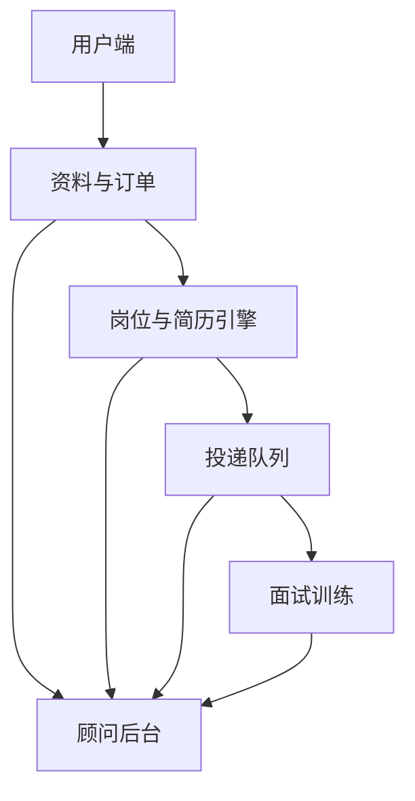
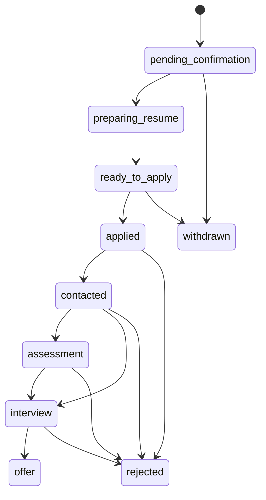
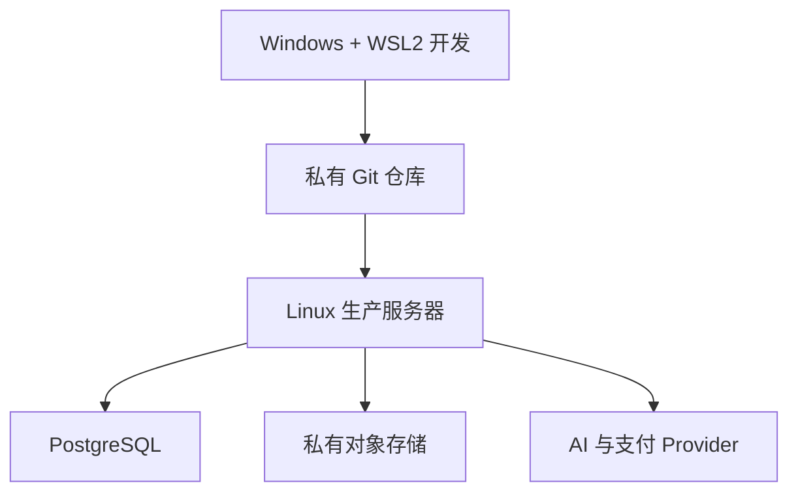

# AI 求职服务全流程 Demo 与 Codex 落地规格（MVP 版）

版本：0.5
适用阶段：个人试运营 → 10 名种子用户 → 产品化验证  
首批目标人群：机械、制造业、生物医药工程及相邻专业的应届生/毕业 1—3 年求职者

## 给 Codex 的执行指令

将本文档视为项目的唯一需求来源，并在当前工作区实现一个可运行、可演示、可测试的完整 MVP。不要只输出方案、代码片段或页面原型；需要创建真实代码、数据库迁移、种子数据、自动化测试、启动脚本和 README，并实际运行测试验证。

执行原则：

1. 先检查当前工作区、`AGENTS.md`、已有代码和 Git 状态，保留用户已有内容。
2. 如果当前工作区为空，在 `ai-job-coach/` 目录创建项目；如果已有同名项目，在原项目上继续。
3. 按本文第 14 节的里程碑持续实现，不能在只完成脚手架后停止。
4. 外部 AI 凭据缺失时，必须使用 Mock Provider 完成可运行闭环；支付和邮件属于后续阶段，第一阶段只保留 Provider 接口与必要数据结构，不实现收款、支付回调和退款流程。
5. 默认开发环境为 Windows 11 + WSL2 Ubuntu，项目、Git、Python、Node.js 和数据库都放在 WSL 文件系统；同时保留 Windows 原生 PowerShell 的备用运行方式，不把 Docker 作为本地运行的前置条件。
6. 所有 AI 输出使用结构化 JSON 校验；简历生成必须经过事实一致性检查。
7. 第三方岗位平台只做人工导入、公开允许来源适配器和用户确认后的辅助投递，不实现绕过登录、验证码或反爬机制。
8. 每完成一个里程碑，运行对应测试并修复失败；最终提供启动方式、演示账号、已完成清单和仍需外部凭据的功能。
9. 如本文前后出现冲突，以第 14—26 节的工程规格为准。
10. 开始编码前必须阅读第 26 节的环境约束；不得把同一个工作区的依赖混装在 Windows 和 WSL，也不得默认把生产服务运行在用户笔记本上。
11. 用户已授权把 `/mnt/e/documents/resume` 中的个人简历作为只读产品与解析参考。不得修改原文件、提交到 Git、复制为种子数据或在日志/最终回复中输出完整个人信息；演示数据必须重新生成并彻底虚构。

### Codex 最终必须交付

- 可运行的 React 用户端与顾问后台；
- 可运行的 FastAPI 后端与自动 API 文档；
- SQLite 开发数据库、迁移和样例数据；
- 简历上传与解析、JD 导入、匹配报告、定制简历、投递队列、模拟面试、套餐展示、演示额度和周报闭环；
- Mock AI、本地文件存储，以及支付 Provider 的空实现/接口占位；
- 可切换的真实 AI Provider 接口；
- `.env.example`、Windows/Unix 启动脚本、README；
- 后端单元/集成测试和至少一条前端端到端主流程测试；
- 不包含真实密钥、用户隐私数据或平台账号密码。

---

## 1. 项目一句话定义

帮助应届生把“找岗位—理解 JD—修改简历—安排投递—准备面试—复盘结果”变成一个有记录、可持续优化的求职流程。

这个项目不是单纯的“AI 改简历”，而是一个由 AI 工具和人工顾问共同完成的求职执行服务。

### 第一阶段的价值主张

> 用户不再每天到处搜索岗位、重复修改简历，而是每周收到适合自己的新岗位、针对岗位的简历版本、投递清单和面试训练。

### 首批用户为什么选择你

- 你本人刚经历机械专业应届生求职，理解“没有亮眼经历、不懂 JD、不知道怎么改简历”的真实痛点。
- 先聚焦制造业、工程类和生物医药工程岗位，比一开始服务所有专业更容易形成专业感。
- 每次修改都对应具体岗位，而不是提供一份放之四海皆准的模板。
- 用户可以看到每次投递、回复、面试和复盘记录。

---

## 2. 产品边界

### 产品可以做

- 收集近期公开岗位信息或接收用户提供的岗位链接。
- 将岗位职责、硬性要求、优先条件和关键词结构化。
- 根据用户真实经历生成岗位定制简历。
- 把用户尚未具备的能力单独列为“能力缺口”。
- 根据能力缺口设计一个真实可完成的练习项目，并标记为个人项目/练习项目。
- 生成岗位面试题、回答框架、追问和模拟面试评分。
- 在用户逐项确认后辅助完成投递，并生成投递记录。

### 第一版不做

- 不自动编造公司、职位、任职时间、学历、证书、项目结果或业绩数字。
- 不以已倒闭公司、常见实习岗位或校级奖项为模板生成虚构履历，也不把他人的职责和成果改写为用户本人经历。
- 不保存招聘网站账号密码并在服务器上无人值守登录。
- 不承诺一定获得 Offer。
- 不抓取需要绕过登录、验证码、付费墙或明显禁止自动访问的页面。
- 不提供“无限修改、无限投递、直到找到工作”为止的无上限服务。

这些限制不是削弱产品，而是为了防止账号封禁、交付成本失控和退款争议。

### 事实纠正与经历补强

事实保护不等于冻结原简历。用户可以纠正解析错误、补充遗漏事实，并把之后真实完成的内容加入事实库。对于缺少实习的用户，系统优先创建可在一至两周内完成的“个人项目”“课程项目”“岗位实践项目”或“公开案例复现”，通过代码、部署记录、截图、文档或演示地址形成证据后再生成简历要点。

- 个人项目必须明确标注为个人项目、练习项目或案例复现，不包装成公司任职；
- 参考他人方案时，只能描述用户实际复现、修改和验证的部分；
- 没有证据的公司任职、奖学金、比赛奖项、证书、工具和量化结果不得进入批准版本；
- JD 要求但事实库没有证据的能力进入“能力缺口”，可以转化为实践项目任务；
- 用户负责确认事实真实，系统负责检查来源与新增主张，顾问负责判断表达、岗位相关性和面试可追问性。

详细执行规则见 [`docs/resume-integrity.md`](docs/resume-integrity.md)。

---

## 3. 服务分层与建议定价

下列价格是试运营假设，必须用前 10 名付费用户的数据调整。

| 套餐 | 试运营价 | 交付内容 | 服务上限 | 建议周期 |
|---|---:|---|---|---|
| 免费诊断 | 0 元 | 1 份简历与 1 个 JD 的匹配报告 | 不改简历、不投递 | 一次性 |
| 基础版 | 299 元 | 简历诊断、主简历重构、5 个具体岗位的定制版本 | 1 次统一修改；不代投 | 7 天 |
| 求职会员 | 699 元/月 | 基础服务、岗位筛选、定制简历、投递队列、周报 | 20 个岗位定制、40 次辅助投递 | 30 天 |
| 面试会员 | 1299 元/月 | 求职会员全部内容、2 次人工模拟面试、面试复盘 | 30 个岗位定制、60 次辅助投递、2 次模拟面试 | 30 天 |
| 年度陪跑 | 暂不公开销售 | 每月岗位筛选、定制、辅助投递、复盘 | 必须设月度上限和最长服务期 | 验证后再售 |

### 年度服务建议

不要在第一阶段推出“今年一直服务到找到为止”。建议在服务过至少 20 名客户、测出平均工时后，再测试：

- 价格：3999—5999 元/年；
- 每月最多 20 个定制岗位、40 次辅助投递；
- 每季度 1 次模拟面试；
- 服务在用户接受 Offer、主动停止求职或满 12 个月时结束；
- 未使用额度不无限累计。

### 结果型服务建议

不做“年底找不到工作无条件退款”。可以测试“基础服务费 + 结果奖励”或“满足交付条件后部分退款”，但正式销售前应让专业人士审阅合同。

退款条件必须同时写明：

- 用户按时提交真实资料；
- 用户完成规定投递量和模拟面试；
- 用户不得长期失联或无故拒绝符合其预设条件的面试；
- 服务方按期交付约定岗位、简历和训练；
- 哪些情况可以退款、退款比例、申请时限和处理时间。

---

## 4. 一名用户的完整体验 Demo

### 示例用户

- 姓名：小陈（虚构案例）
- 背景：机械本科应届生，只有毕业设计和一段非核心实习
- 目标：杭州设备工程师、机械助理工程师、公用系统工程师
- 当前问题：海投无回复，不知道不同岗位是否需要不同简历

### Step 1：从内容进入

小陈在小红书看到一篇内容：

> 《杭州机械应届生：今天新发布的 12 个岗位，哪些真的接受无经验？》

文末行动按钮：

> 免费领取“1 个 JD + 1 份简历匹配报告”，填写表单即可。

### Step 2：填写免费诊断表

表单字段：

- 姓名/称呼；
- 微信或邮箱；
- 学校、专业、毕业时间；
- 目标城市、岗位、行业；
- 是否接受出差、轮班、工厂环境；
- 期望薪资；
- 简历文件；
- 一个目标岗位链接或 JD；
- 明确授权：允许为了本次求职服务处理简历与岗位信息；
- 是否允许匿名使用修改前后案例进行展示，默认“不允许”。

### Step 3：系统生成免费报告

示例输出：

```text
综合匹配：可尝试

硬性条件：4/5
- 本科学历：满足
- 机械相关专业：满足
- 接受轮班：需要用户确认
- CAD 基础：简历有证据
- 设备维护经验：证据不足

简历主要问题：
1. 毕业设计只写了题目，没有写设计指标和个人贡献。
2. 实习经历偏销售，未提炼沟通、跟进和问题闭环能力。
3. 没有针对 JD 中“设备点检、SOP、跨部门协作”建立证据。

下一步建议：
- 重写毕业设计为 3 条有指标、有动作的项目描述；
- 保留销售实习，但改写为客户需求确认、问题跟踪和反馈分析；
- 面试前补一个“设备点检表与故障复盘”练习项目。
```

免费报告只解决“问题是什么”，付费服务解决“具体怎么改、投哪里、如何训练”。

### Step 4：咨询与成交

15 分钟咨询话术：

1. 你过去两周投过多少岗位，得到多少回复？
2. 你最想做什么岗位，哪些条件不能接受？
3. 你现在最大的阻力是岗位来源、简历、投递执行还是面试？
4. 说明匹配报告中的 2 个关键问题。
5. 推荐最小套餐，不主动推年度服务。

成交表达示例：

> 你的问题不是完全没有经历，而是经历没有转化成招聘方能识别的证据。基础版会先重构一份主简历，再针对 5 个你确认的岗位分别调整。7 天内交付，统一包含一次修改，价格 299 元。

### Step 5：收款与订单确认

试运营阶段：

1. 给用户发送服务说明、价格、交付时间、修改次数和退款条件；
2. 用户回复确认；
3. 使用合适的商户收款方式收款；
4. 在订单表登记订单号、套餐、金额、付款时间、预计交付时间；
5. 给用户发送《资料补充清单》与订单确认信息。

不要仅凭一张转账截图判断付款；以收款后台实际到账为准。

### Step 6：正式交付

基础版 7 天交付节奏：

| 时间 | 动作 | 产物 |
|---|---|---|
| 第 0 天 | 收款、收集资料、确认目标 | 用户画像、事实库 |
| 第 1 天 | 重构主简历 | 主简历 V1 |
| 第 2 天 | 用户核实所有事实 | 事实确认记录 |
| 第 3—5 天 | 选择 5 个岗位并生成定制版本 | 5 份岗位简历 |
| 第 6 天 | 统一修改 | 最终版文件 |
| 第 7 天 | 交付总结 | 使用说明、投递建议 |

会员版每周交付：

- 周一：本周岗位池；
- 周二：用户勾选目标岗位；
- 周三至周五：生成定制简历并进入投递队列；
- 周日：投递数据周报和下周策略。

### Step 7：投递与反馈

每次投递记录：

```text
公司 / 岗位 / 城市 / 来源链接 / 发布日期
匹配理由 / 风险点 / 使用的简历版本
用户确认时间 / 投递时间 / 当前状态
回复 / 测评 / 面试 / 拒绝原因 / 下一步动作
```

### Step 8：触发模拟面试

收到面试邀请后，系统根据以下内容生成题库：

- JD 的职责与硬性要求；
- 用户实际简历；
- 公司与岗位公开信息；
- 用户此前模拟面试的薄弱项。

人工模拟面试 45 分钟，结束后交付：

- 评分表；
- 三个最危险的问题；
- 推荐回答结构；
- 需要补充的事实或知识；
- 下一次训练任务。

---

## 5. 获客全流程

### 5.1 初始定位

第一阶段不要宣传“全行业 AI 求职平台”，而是宣传：

> 面向机械、制造业和生物医药工程应届生的岗位筛选、定制简历和面试陪跑。

这个定位与你自己的教育和求职经历相符，也更容易生产可信内容。不得使用雇主的内部资料、未公开流程或保密信息作为内容素材。

### 5.2 免费产品

免费入口只能有一个：

> 1 个 JD + 1 份简历免费匹配报告。

它同时承担三项任务：

- 给用户立即价值；
- 收集用户画像；
- 判断用户是否有真实付费需求。

### 5.3 内容栏目

每周围绕四类内容发布：

1. **岗位情报**：某城市、专业、行业近期新岗位。
2. **JD 拆解**：一句招聘要求背后到底要什么证据。
3. **简历案例**：匿名展示修改前后差异，不夸大结果。
4. **面试训练**：一个高频问题、错误回答和回答框架。

### 5.4 渠道顺序

| 渠道 | 内容形式 | 主要目的 |
|---|---|---|
| 小红书 | 岗位清单、简历对比图、求职复盘 | 获取精准搜索流量 |
| 抖音/B 站 | JD 拆解、改简历录屏、模拟面试片段 | 建立信任 |
| 知乎/牛客 | 长文、岗位经验、面试问答 | 获取长期搜索流量 |
| 微信群/校友群 | 免费分享、直播答疑 | 获得首批种子用户 |
| 老客户转介绍 | 成功案例和推荐奖励 | 降低获客成本 |

不要在招聘平台私信中批量骚扰求职者，也不要购买来源不明的简历名单。

### 5.5 一周内容模板

| 星期 | 内容 |
|---|---|
| 周一 | 本周新岗位清单 |
| 周二 | 1 个 JD 深度拆解 |
| 周三 | 1 份匿名简历修改前后 |
| 周四 | 1 个面试问题演示 |
| 周五 | 本周投递数据与经验复盘 |
| 周末 | 直播/语音答疑，邀请免费诊断 |

### 5.6 转化漏斗 Demo

以下是验证目标，不是结果保证：

```text
10,000 次内容曝光
→ 200 人进入表单（2%）
→ 80 人完成资料（40%）
→ 30 人接受简短咨询（37.5%）
→ 6 人购买基础版（20%）
→ 收入 1,794 元
```

每周只跟踪七个指标：曝光、表单访问、有效线索、完成诊断、咨询、付款、退款。

---

## 6. 收款实现（后续阶段，MVP-1 不实施）

本节用于保留未来设计，不属于当前 Codex 第一阶段的完成条件。MVP-1 不开发支付页面、支付回调、自动退款或真实商户接入，也不要求通过付款才能使用核心流程。

第一阶段采用管理员/种子脚本直接发放演示额度，或者让本地 Demo 用户拥有固定测试额度。等简历分析、岗位匹配、定制简历、投递管理和面试训练跑通并出现真实付费意愿后，再进入本节的实施。

### 未来阶段 A：0—10 个客户

目标不是开发支付系统，而是验证服务：

- 明示服务内容、价格、交付时间、修改次数和退款规则；
- 使用与经营主体和业务场景相匹配的商户收款产品；
- 人工核对到账并把订单标记为“已支付”；
- 给每个订单生成唯一编号，例如 `ORD-202607-001`；
- 保存服务确认、交付和退款记录。

### 未来阶段 B：网页自动收款

当用户稳定后，再接入商户支付：

```text
用户选择套餐
→ 后端创建本地订单（pending）
→ 调用支付平台创建支付单
→ 用户完成付款
→ 支付平台回调后端
→ 后端验证签名和金额
→ 订单改为 paid
→ 自动开通对应服务额度
```

订单状态：

```text
pending → paid → delivering → completed
                 ↘ refund_pending → refunded
```

后端必须核验支付回调，不能由前端页面自行把订单改成已付款。支付密钥只保存在服务器环境变量中。

支付宝开放平台提供面向商家的应用与支付接入能力；具体产品、主体资质和接入步骤以申请时的官方说明为准：<https://open.alipay.com/>。

### 未来阶段 C：发票、退款和对账

- 每日订单金额与收款后台核对；
- 每笔退款关联原订单；
- 不用新转账替代原路退款，除非支付产品不支持且双方书面确认；
- 按适用规定保存必要的订单、服务和财务记录；
- 正式经营前确认经营主体、税务、发票和人力资源服务相关要求。

---

## 7. 技术系统设计

### 7.1 MVP 固定技术栈

为减少 Codex 实现时的歧义，MVP 固定采用：

- 前端：React + TypeScript + Vite + React Router + TanStack Query；
- 样式：Tailwind CSS；不依赖收费 UI 套件；
- 表单：React Hook Form + Zod；
- 后端：Python 3.12+、FastAPI、Pydantic、SQLAlchemy、Alembic；
- 数据库：SQLite（开发与 Demo），通过 SQLAlchemy 保留迁移到 PostgreSQL 的能力；
- 文件解析：`python-docx`、`pdfplumber`；扫描 PDF 在 MVP 中明确提示暂不支持 OCR；
- AI：Provider 接口 + Mock Provider + 一个环境变量可配置的兼容 Chat Completions Provider；
- 后台任务：MVP 使用 FastAPI BackgroundTasks/应用内任务服务，不引入 Redis；
- 文件存储：工作区内私有目录，数据库只保存随机化文件路径，不直接保存原文件名；
- 身份认证：邮箱密码 + HttpOnly Cookie/JWT，密码使用安全哈希；
- 测试：Pytest、Vitest、React Testing Library、Playwright；
- 开发方式：前后端分别启动，并提供 PowerShell 和 Bash 一键脚本；
- 生产准备：保留 PostgreSQL、对象存储、真实支付和真实邮件 Provider 接口，但不要求 MVP 接入凭据。

Y7000 2021 足够开发这套系统，因为模型推理主要在云端完成。

### 7.2 系统模块



### 7.3 核心数据表

| 表 | 关键字段 |
|---|---|
| users | 用户、联系方式、目标、授权状态 |
| resumes | 原始简历、解析文本、事实库、版本 |
| jobs | 公司、岗位、城市、JD、来源、发布时间、状态 |
| matches | 用户、岗位、匹配分、证据、缺口、风险 |
| resume_versions | 用户、岗位、生成版本、事实确认状态 |
| applications | 岗位、简历版本、投递时间、状态、反馈 |
| interviews | 岗位、题库、录音授权、评分、复盘 |
| orders | 套餐、金额、支付状态、额度、退款状态 |
| audit_logs | 谁在什么时候查看或修改了什么 |

### 7.4 岗位采集

按风险从低到高排序：

1. 用户粘贴 JD；
2. 用户提交公开岗位链接；
3. 企业官方招聘页、允许使用的公开接口或订阅源；
4. 经确认允许自动访问的公开页面；
5. 第三方招聘平台自动化采集——最后考虑。

每个来源写成独立适配器：

```python
class JobSource:
    def fetch(self) -> list[dict]: ...
    def normalize(self, raw: dict) -> dict: ...
    def deduplicate_key(self, job: dict) -> str: ...
```

标准岗位结构：

```json
{
  "company": "示例公司",
  "title": "设备工程师",
  "city": "杭州",
  "published_at": "2026-07-13",
  "source_url": "https://example.com/job/123",
  "responsibilities": [],
  "must_have": [],
  "nice_to_have": [],
  "keywords": [],
  "work_conditions": [],
  "salary_text": "",
  "content_hash": ""
}
```

去重建议使用：公司标准名 + 岗位名 + 城市 + JD 内容哈希。过期岗位需要定期复查并标记，不直接删除历史投递记录。

### 7.5 简历解析与事实库

上传简历后先解析为事实库，AI 只能在事实库范围内改写：

```json
{
  "education": [],
  "employment": [],
  "projects": [],
  "skills": [],
  "certificates": [],
  "verified_metrics": [],
  "unverified_claims": []
}
```

任何新数字、新工具、新成果先进入 `unverified_claims`，必须由用户确认后才能进入正式简历。

### 7.6 JD 匹配引擎

匹配报告不只输出一个分数，而要输出证据：

| 维度 | 权重示例 | 判断方式 |
|---|---:|---|
| 硬性条件 | 30 | 学历、专业、城市、毕业时间、班次 |
| 技能匹配 | 25 | 简历是否有工具和技能证据 |
| 经历证据 | 20 | 是否有相似任务、项目或结果 |
| 关键词覆盖 | 10 | 是否使用招聘方能识别的表达 |
| 求职偏好 | 10 | 薪资、地点、出差、行业 |
| 岗位时效 | 5 | 发布时间和是否仍有效 |

输出必须区分：满足、有弱证据、缺失、需要用户确认、不可判断。

### 7.7 定制简历生成

生成流程：

```text
锁定用户事实库
→ 提取 JD 关键能力
→ 为每项能力寻找真实证据
→ 重排模块和要点
→ 用动作—任务—结果结构改写
→ 检查新增事实和数字
→ 用户确认
→ 提交顾问审核
→ 顾问批准或退回
→ 导出 DOCX 或单页 HTML（浏览器打印 PDF）
```

系统提示词核心约束：

```text
你是求职简历编辑。只能使用“用户事实库”中的事实。
可以重写、压缩、排序和突出相关内容；不得新增公司、岗位、
时间、工具、证书、职责、成果或未经确认的数字。
没有证据的岗位要求必须放入“能力缺口”，不得写入简历。
输出：修改后的要点、修改理由、对应 JD 要求、事实来源编号。
```

### 7.8 辅助投递

第一版采用“投递队列 + 用户确认”：

```text
系统推荐岗位
→ 用户勾选
→ 生成对应简历和回答草稿
→ 用户核对
→ 打开原始岗位页面
→ 用户自行提交或在场人工辅助
→ 系统登记结果
```

这样无需把招聘网站密码交给你的服务器。后续可开发浏览器扩展，帮助用户自动填写重复字段，但每次正式提交仍由用户确认。

### 7.9 面试模块

面试题分为：

- 简历真实性追问；
- JD 专业知识；
- 行为问题；
- 工作条件与稳定性；
- 用户薄弱项追问。

评分维度：内容真实性、结构、相关性、具体性、表达清晰度、追问稳定性。系统输出改进建议，最终评价由人工顾问确认。

### 7.10 API Demo

```text
POST /api/intake                    创建用户资料
POST /api/resumes/upload            上传并解析简历
POST /api/jobs/import               导入 JD/链接
POST /api/matches                   生成匹配报告
POST /api/resume-versions           生成岗位定制版
POST /api/applications/queue        加入投递队列
PATCH /api/applications/{id}        更新投递状态
POST /api/interviews/generate       生成面试题
GET  /api/packages                  查看套餐说明
GET  /api/quotas                    查看演示额度
GET  /api/reports/weekly            生成求职周报
```

---

## 8. 交付后台 Demo

顾问每天只看一个工作台：

| 队列 | 要处理的内容 |
|---|---|
| 新线索 | 尚未生成免费报告 |
| 待咨询 | 已完成报告、尚未沟通 |
| 待付款 | 已确认套餐、尚未到账 |
| 待核实 | AI 标记的新事实或不确定信息 |
| 待修改 | 需要人工审核的简历版本 |
| 待投递 | 用户已确认的岗位 |
| 有面试 | 需要生成题库或预约模拟面试 |
| 待复盘 | 已面试但尚未记录结果 |
| 退款/争议 | 超时、退款和投诉处理 |

每名会员每周收到一份周报：

```text
新增岗位：18
用户确认：10
完成投递：8
已读/沟通：2
面试邀请：1
本周问题：岗位范围过窄；项目证据不足
下周动作：增加设备维护相邻岗位；完成点检练习项目
```

---

## 9. 隐私、授权和服务合规最低要求

简历含有姓名、电话、邮箱、教育和工作经历。系统上线前至少做到：

- 明确告知处理目的、方式、信息种类、保存期限和联系方式；
- 只收集完成服务所必需的信息；
- 用户能够更正、下载或要求删除资料；
- 默认不把客户案例用于宣传；
- 原始简历、导出文件和后台访问设置权限；
- 不把完整简历写入普通日志；
- 供应商、模型接口和存储服务只传输必要内容；
- 发生泄露时有通知、处置和记录流程。

《个人信息保护法》要求处理个人信息前以清晰方式告知处理目的、方式、种类和保存期限，并原则上把保存期限控制在实现目的所需的最短时间：<https://www.spp.gov.cn/spp/fl/202108/t20210820_527244.shtml>。

从事经营性网络招聘服务可能涉及人力资源服务许可、收费明示和招聘信息管理要求。正式公开经营前，应根据实际业务模式向所在地主管部门或专业人士确认。相关依据：

- 《网络招聘服务管理规定》：<https://www.moj.gov.cn/pub/sfbgw/flfggz/flfggzbmgz/202103/t20210309_374224.html>
- 2026 年关于规范网络平台招聘类信息发布的通知：<https://www.cac.gov.cn/2026-01/15/c_1770207718756257.htm>

---

## 10. 30 天实施计划

### 第 1 周：不用开发，跑通人工服务

- 建立用户登记表、订单表、岗位表和投递表；
- 做一份免费匹配报告模板；
- 做一份服务说明和基础版报价；
- 找 3 名目标用户免费或低价体验；
- 记录完成每一步所需时间。

验收标准：可以从收到简历走到交付 5 个岗位版本，且所有修改可追溯到用户事实。

### 第 2 周：开发本地 Demo

- 完成简历上传；
- 完成 JD 粘贴；
- 解析为结构化数据；
- 生成匹配报告；
- 生成一份事实受控的简历修改建议。

验收标准：在 Y7000 上能打开网页完成一次完整分析。

### 第 3 周：加入岗位库和顾问后台

- 先接企业官方招聘页或人工导入；
- 完成岗位去重、发布时间和过期标记；
- 加入顾问处理队列；
- 生成投递记录和周报。

验收标准：可以同时管理 10 名用户，不依赖聊天记录找资料。

### 第 4 周：开始收费验证

- 连续发布 7—10 条内容；
- 获取至少 30 个有效表单；
- 完成至少 10 次免费诊断；
- 尝试成交 3 名基础版用户；
- 统计获客、交付工时、退款和面试转化。

验收标准：不是“平台看起来完整”，而是出现第一笔真实收入且能够按时交付。

---

## 11. 第一阶段的财务模型

假设一个基础版售价 299 元：

| 成本 | 假设 |
|---|---:|
| AI/API 与文件处理 | 10 元 |
| 人工沟通与修改 | 2 小时 |
| 按个人时间 50 元/小时计 | 100 元 |
| 支付、售后和其他预留 | 20 元 |
| 估算贡献利润 | 169 元 |

如果每个基础版实际需要 5 小时，你就不是软件业务，而是在低价出售人工时间。因此试运营最重要的数据是“每个交付步骤花了多少分钟”。

每周容量建议：

- 前两周最多接 3 个付费客户；
- 流程稳定后最多同时服务 10 个会员；
- 模拟面试提前预约，不承诺随时进行；
- 超过容量就排期，不用降质量换销量。

---

## 12. 关键指标与继续/停止条件

### 产品指标

- 免费报告完成时间；
- 一份岗位定制简历的人工审核时间；
- 用户确认岗位比例；
- 投递到沟通、测评、面试的转化；
- 退款率和争议率；
- 每名客户每月贡献利润。

### 30 天继续条件

满足以下三项再继续开发：

1. 至少 3 名非熟人愿意付费；
2. 单个基础版能在 3 小时内完成；
3. 至少有用户因为服务获得更多有效沟通或面试机会。

如果没人付款，不要先做爬虫和支付系统；先检查定位、免费报告、报价和销售沟通。如果有人付款但交付太慢，优先做模板和后台自动化。

---

## 13. 今天就能开始的最小清单

1. 确定首批只服务机械/制造业/生物医药工程求职者。
2. 制作一张用户信息表和一张岗位投递表。
3. 找一个真实 JD，用自己的简历跑出第一份免费报告样例。
4. 做一篇“岗位 JD 拆解 + 免费匹配报告”内容。
5. 邀请 3 名应届生体验，完整记录工时和反馈。
6. 第 4 名开始尝试收取 99—299 元，而不是继续无限免费。

第一阶段的目标不是造出一个看起来很大的平台，而是证明这条链路成立：

> 内容带来线索 → 免费诊断建立信任 → 用户付款 → 按时交付 → 投递数据改善 → 用户愿意推荐。

---

## 14. Codex 工程实施顺序

Codex 必须按下面顺序实施。每个阶段完成后运行测试并记录结果，不得跳过基础数据和权限直接制作静态页面。

### 里程碑 0：仓库与运行环境

交付：

- 创建前后端目录、根目录 README、`.gitignore`、`.env.example`；
- 创建 `scripts/dev.ps1`、`scripts/dev.sh`、`scripts/test.ps1`、`scripts/test.sh`；
- 后端 `/api/health` 返回数据库和应用状态；
- 前端可以读取 `/api/health` 并显示“服务正常”；
- 初始化 Alembic，创建第一版数据库迁移；
- 增加种子数据命令。

验收：

- Windows PowerShell 和 Bash 的步骤都写进 README；
- 未配置 AI 密钥时仍能启动，MVP-1 不需要支付密钥；
- 后端测试、前端测试至少各有一个通过用例。

### 里程碑 1：用户、简历、岗位和匹配

交付：

- 注册、登录、退出、当前用户接口；
- 用户资料与求职偏好表单；
- DOCX/文本型 PDF 上传、解析、删除；
- 用户确认“事实库”；
- 粘贴 JD 和手动创建岗位；
- 确定性匹配评分 + Mock AI 解释；
- 匹配报告页面。

验收：

- 用户 A 不能读取用户 B 的简历或报告；
- 不支持的文件返回可理解错误；
- 同一份输入在 Mock 模式下得到稳定结果；
- 匹配报告展示分项得分、证据、缺口和待确认项。

### 里程碑 2：定制简历、投递与顾问后台

交付：

- 基于事实库和 JD 生成定制简历草稿；
- 新增事实拦截、用户事实确认、顾问审核状态；
- 导出 DOCX，并提供经过 HTML 转义的单页 A4 预览/下载；
- 投递队列、状态更新和历史记录；
- 顾问工作台的九个处理队列；
- 用户周报。

验收：

- 未确认的新事实不能进入最终 DOCX；
- 每个简历要点能追溯到事实来源 ID；
- 投递状态变化写入事件日志；
- 顾问只能查看被分配的客户，管理员可查看全部。

### 里程碑 3：面试、演示额度与完整演示

交付：

- 从 JD + 简历生成模拟面试题；
- 面试评分表与复盘；
- 套餐展示、管理员/种子脚本发放演示额度；
- 免费诊断额度和演示额度校验；
- 支付 Provider 接口占位和明确的 `NotImplemented` 降级，不制作支付页面、回调和退款流程；
- 完整种子案例和 Playwright 主流程；
- 隐私说明、服务说明和删除资料入口。

验收：

- 管理员或种子脚本发放额度后正确写入额度账本；
- 相同幂等键不会重复增加额度；
- 额度用尽时返回明确提示；
- 完成从注册到周报的端到端演示。

### 里程碑 4：最终 QA

Codex 最后必须：

1. 运行数据库迁移；
2. 导入种子数据；
3. 运行后端测试；
4. 运行前端测试；
5. 运行 Playwright 主流程；
6. 检查仓库内是否误提交 `.env`、数据库文件、用户上传文件和密钥；
7. 启动前后端并验证健康接口；
8. 在最终说明中列出真实执行过的命令和结果。

---

## 15. 代码目录与模块职责

Codex 应创建以下结构。可以为工程需要增加文件，但不得把所有逻辑堆进单个文件。

```text
ai-job-coach/
├─ README.md
├─ AGENTS.md
├─ .env.example
├─ .gitignore
├─ docs/
│  ├─ product-spec.md
│  ├─ api.md
│  ├─ privacy.md
│  └─ demo-script.md
├─ scripts/
│  ├─ dev.ps1
│  ├─ dev.sh
│  ├─ test.ps1
│  ├─ test.sh
│  └─ seed_demo.py
├─ apps/
│  ├─ api/
│  │  ├─ pyproject.toml
│  │  ├─ alembic.ini
│  │  ├─ alembic/
│  │  ├─ app/
│  │  │  ├─ main.py
│  │  │  ├─ config.py
│  │  │  ├─ database.py
│  │  │  ├─ dependencies.py
│  │  │  ├─ models/
│  │  │  ├─ schemas/
│  │  │  ├─ api/routes/
│  │  │  ├─ services/
│  │  │  │  ├─ resume_parser.py
│  │  │  │  ├─ fact_guard.py
│  │  │  │  ├─ job_normalizer.py
│  │  │  │  ├─ matcher.py
│  │  │  │  ├─ resume_generator.py
│  │  │  │  ├─ interview_generator.py
│  │  │  │  ├─ quota_service.py
│  │  │  │  └─ report_service.py
│  │  │  ├─ providers/
│  │  │  │  ├─ llm/base.py
│  │  │  │  ├─ llm/mock.py
│  │  │  │  ├─ llm/compatible.py
│  │  │  │  ├─ payment/base.py
│  │  │  │  ├─ payment/disabled.py
│  │  │  │  └─ storage/local.py
│  │  │  └─ templates/
│  │  └─ tests/
│  └─ web/
│     ├─ package.json
│     ├─ vite.config.ts
│     ├─ src/
│     │  ├─ app/
│     │  ├─ api/
│     │  ├─ components/
│     │  ├─ features/
│     │  ├─ pages/
│     │  ├─ routes/
│     │  ├─ types/
│     │  └─ test/
│     └─ e2e/
├─ data/
│  └─ samples/
│     ├─ sample_resume.docx
│     ├─ sample_job.json
│     └─ sample_match.json
└─ var/
   ├─ app.db
   └─ uploads/
```

`var/`、真实上传文件和本地数据库必须加入 `.gitignore`。样例文件必须是完全虚构的数据。

### 根目录 AGENTS.md 应写明

- 本文档与 `docs/product-spec.md` 是需求来源；
- 修改后必须运行对应测试；
- 不把 AI 生成文本直接视为事实；
- 数据库结构变更必须创建 Alembic 迁移；
- 新增外部服务必须实现 Base Provider 与 Mock Provider；
- 不在代码或日志中写入密钥和完整简历；
- 前端显示的中文文案应清晰，代码标识符使用英文。

---

## 16. 环境变量与运行方式

`.env.example` 至少包含：

```dotenv
APP_ENV=development
APP_NAME=AI Job Coach
APP_SECRET_KEY=replace-in-production
DATABASE_URL=sqlite:///./var/app.db
FRONTEND_ORIGIN=http://localhost:5173
API_BASE_URL=http://localhost:8000

AUTH_COOKIE_NAME=ai_job_session
AUTH_COOKIE_SECURE=false
ACCESS_TOKEN_EXPIRE_MINUTES=1440

LLM_PROVIDER=mock
LLM_API_BASE_URL=
LLM_API_KEY=
LLM_MODEL=
LLM_TIMEOUT_SECONDS=60

PAYMENT_PROVIDER=disabled
PAYMENT_WEBHOOK_SECRET=demo-secret

STORAGE_PROVIDER=local
LOCAL_STORAGE_PATH=./var/uploads
MAX_UPLOAD_MB=10
DATA_RETENTION_DAYS=180

DEMO_ADMIN_EMAIL=admin@example.test
DEMO_ADMIN_PASSWORD=ChangeMe123!
DEMO_ADVISOR_EMAIL=advisor@example.test
DEMO_ADVISOR_PASSWORD=ChangeMe123!
DEMO_USER_EMAIL=user@example.test
DEMO_USER_PASSWORD=ChangeMe123!
```

### README 启动步骤

后端：

```bash
cd apps/api
python -m venv .venv
# Windows: .venv\Scripts\Activate.ps1
# Bash: source .venv/bin/activate
pip install -e .[dev]
alembic upgrade head
python ../../scripts/seed_demo.py
uvicorn app.main:app --reload --port 8000
```

前端：

```bash
cd apps/web
npm install
npm run dev
```

不得要求用户全局安装数据库、Redis 或 Docker。测试和启动脚本需检查依赖并给出友好提示。

---

## 17. 用户角色、权限和数据隔离

### 角色

| 角色 | 权限 |
|---|---|
| user | 管理自己的资料、简历、岗位、报告、投递、面试和订单 |
| advisor | 查看被分配客户，审核简历，管理投递和模拟面试 |
| admin | 管理全部用户、套餐、订单、分配关系和系统设置 |

### 权限规则

- 所有包含用户数据的查询必须带用户所有权或顾问分配条件；
- 前端隐藏按钮不等于权限控制，后端必须再次校验；
- 用户删除账号时先进入 `deletion_requested`，Demo 提供管理员执行清理的操作；
- 顾问不得直接修改用户事实，只能提出修改并等待用户确认；
- 管理员敏感操作写入审计日志；
- 下载文件使用短期签名 token 或鉴权接口，不暴露真实磁盘路径。

### 最小认证接口

```text
POST /api/auth/register
POST /api/auth/login
POST /api/auth/logout
GET  /api/auth/me
POST /api/auth/change-password
DELETE /api/account
```

MVP 可以不做邮箱验证码和忘记密码邮件，但页面必须明确标记为待接入邮件 Provider 的功能。

---

## 18. 页面与交互规格

所有页面必须有加载、空状态、错误状态和成功提示，不能只实现正常路径。

### 18.1 公共页面

#### `/`

- 一句话价值主张；
- “免费匹配一次”按钮；
- 三步说明：上传简历、导入 JD、得到行动报告；
- 套餐卡片；
- 隐私和服务边界；
- 登录/注册入口。

#### `/pricing`

- 展示免费、基础、求职会员、面试会员；
- 明确额度、周期、修改次数和不包含内容；
- 点击购买后进入订单确认。

### 18.2 用户页面

#### `/app/onboarding`

分步填写：基本信息 → 求职偏好 → 工作条件 → 上传简历 → 授权确认。支持保存草稿。

#### `/app/dashboard`

展示：本周新增岗位、待确认岗位、待审核简历、已投递、面试邀请、剩余额度和下一步任务。

#### `/app/resumes`

- 原始简历列表；
- 解析状态；
- 事实库查看/编辑/确认；
- 定制版本列表；
- 事实风险提示；
- DOCX 下载、单页 HTML 预览与下载；

#### `/app/jobs`

- 粘贴 JD、新建岗位；
- 岗位列表和筛选；
- 发布时间、来源、状态；
- 查看岗位结构化信息；
- 生成匹配。

#### `/app/matches/:id`

- 总体建议：优先、可尝试、低优先、不建议；
- 六个匹配维度；
- 每项证据来源；
- 能力缺口；
- 待用户确认；
- “生成定制简历”和“加入投递队列”。

#### `/app/applications`

看板列：待确认、待生成简历、待投递、已投递、有沟通、测评、面试、Offer、拒绝、已撤回。支持列表视图。

#### `/app/interviews`

- 选择目标岗位和简历版本；
- 生成题库；
- 填写/编辑回答；
- 顾问评分；
- 查看复盘与训练任务。

#### `/app/orders`

- MVP-1 只显示套餐说明、当前额度和额度变化记录；
- 显示“在线支付尚未开放”的明确提示；
- 不提供 Mock 支付按钮和退款申请入口。

#### `/app/settings`

- 修改求职偏好；
- 下载个人数据；
- 请求删除账号；
- 查看授权和隐私说明。

### 18.3 顾问/管理员页面

#### `/advisor`

展示第 8 节定义的九个队列，每条任务显示截止时间、用户、套餐、风险等级和下一动作。

#### `/advisor/clients/:id`

展示用户目标、事实库、岗位、简历、投递、面试和订单时间线；敏感操作必须确认。

#### `/admin/packages`

套餐 CRUD、额度字段、启用/停用。已经购买的订单保存套餐快照，不因后续改价而变化。

#### `/admin/orders`

MVP-1 不实现订单支付操作。管理员只查看额度账本并通过带原因、幂等键和审计记录的操作发放/调整演示额度。订单筛选、人工确认支付和退款属于后续阶段。

---

## 19. 数据模型详细规格

主键统一使用 UUID 字符串；时间统一存 UTC，前端按用户时区展示；软删除字段使用 `deleted_at`。

### users

```text
id, email, password_hash, display_name, role,
status, timezone, created_at, updated_at, deleted_at
```

`role`: `user | advisor | admin`  
`status`: `active | suspended | deletion_requested | deleted`

### user_profiles

```text
user_id, school, major, graduation_year, education_level,
target_cities_json, target_roles_json, target_industries_json,
salary_min, salary_max, accepts_shift, accepts_travel,
accepts_factory, notes, consent_version, consented_at
```

### advisor_assignments

```text
id, user_id, advisor_id, assigned_at, ended_at, status
```

### resumes

```text
id, user_id, original_file_key, original_media_type,
display_name, parse_status, parsed_text, parser_version,
created_at, updated_at, deleted_at
```

`parse_status`: `uploaded | processing | parsed | needs_review | failed`

### resume_facts

```text
id, resume_id, user_id, category, label, value_json,
source_text, source_location, verification_status,
created_by, confirmed_at, created_at, updated_at
```

`verification_status`: `extracted | user_confirmed | user_rejected | proposed`

### jobs

```text
id, created_by, company_name, title, city, salary_text,
published_at, source_type, source_url, raw_jd,
responsibilities_json, must_have_json, nice_to_have_json,
keywords_json, work_conditions_json, content_hash,
status, created_at, updated_at
```

`source_type`: `manual | user_url | company_site | sample`  
`status`: `active | expired | closed | unknown`

### matches

```text
id, user_id, resume_id, job_id, scoring_version,
total_score, recommendation, dimension_scores_json,
evidence_json, gaps_json, confirmations_json,
ai_explanation_json, created_at
```

### resume_versions

```text
id, user_id, base_resume_id, job_id, title,
content_json, traceability_json, guard_status,
review_status, reviewed_by, reviewed_at,
export_file_key, created_at, updated_at
```

`guard_status`: `pending | passed | blocked`  
`review_status`: `draft | user_review | advisor_review | approved | rejected`

### applications

```text
id, user_id, job_id, resume_version_id, status,
source_url, user_confirmed_at, applied_at,
last_response_at, next_action_at, notes,
created_at, updated_at
```

### application_events

```text
id, application_id, from_status, to_status,
actor_user_id, note, created_at
```

### interviews

```text
id, user_id, job_id, resume_version_id,
status, scheduled_at, question_set_json,
answers_json, scorecard_json, feedback_json,
advisor_id, created_at, updated_at
```

### packages

```text
id, code, name, price_cents, billing_period,
resume_quota, application_quota, interview_quota,
features_json, is_active, created_at, updated_at
```

### orders

```text
id, order_number, user_id, package_id,
package_snapshot_json, amount_cents, currency,
status, payment_provider, provider_order_id,
paid_at, completed_at, created_at, updated_at
```

`status`: `pending | paid | delivering | completed | refund_pending | refunded | cancelled`

### quota_ledger

```text
id, user_id, order_id, quota_type, delta,
reason, reference_type, reference_id,
expires_at, idempotency_key, created_at
```

额度余额必须由账本求和或可靠缓存得出，不只在用户表保存一个可被覆盖的数字。

### audit_logs

```text
id, actor_user_id, action, entity_type, entity_id,
metadata_json, ip_hash, created_at
```

审计日志不得写入密码、令牌、完整简历或支付密钥。

---

## 20. API 合同与错误规范

API 统一前缀 `/api`，JSON 字段使用 `snake_case`。成功列表响应：

```json
{
  "items": [],
  "page": 1,
  "page_size": 20,
  "total": 0
}
```

错误响应统一为：

```json
{
  "error": {
    "code": "RESUME_FACTS_NOT_CONFIRMED",
    "message": "请先确认简历事实库后再生成定制版本。",
    "details": {},
    "request_id": "uuid"
  }
}
```

不得把 Python 堆栈、SQL、磁盘路径或 Provider 原始密钥错误返回前端。

### 20.1 简历接口

```text
POST   /api/resumes                         multipart 上传
GET    /api/resumes
GET    /api/resumes/{resume_id}
DELETE /api/resumes/{resume_id}
GET    /api/resumes/{resume_id}/facts
PATCH  /api/resume-facts/{fact_id}
POST   /api/resume-facts/{fact_id}/confirm
POST   /api/resume-facts/{fact_id}/reject
POST   /api/resume-versions
GET    /api/resume-versions/{version_id}
POST   /api/resume-versions/{version_id}/submit-review
GET    /api/resume-versions/{version_id}/preview
GET    /api/resume-versions/{version_id}/download
```

`POST /api/resume-versions` 请求：

```json
{
  "base_resume_id": "uuid",
  "job_id": "uuid",
  "match_id": "uuid"
}
```

创建时扣除一次 `resume` 额度。必须使用幂等键，网络重试不能重复扣额度。

### 20.2 岗位与匹配接口

```text
POST   /api/jobs/manual
POST   /api/jobs/import-text
GET    /api/jobs
GET    /api/jobs/{job_id}
PATCH  /api/jobs/{job_id}
POST   /api/jobs/{job_id}/expire
POST   /api/matches
GET    /api/matches
GET    /api/matches/{match_id}
```

`POST /api/matches` 请求：

```json
{
  "resume_id": "uuid",
  "job_id": "uuid"
}
```

### 20.3 投递接口

```text
POST  /api/applications
GET   /api/applications
GET   /api/applications/{application_id}
PATCH /api/applications/{application_id}/status
POST  /api/applications/{application_id}/confirm
GET   /api/applications/{application_id}/events
```

允许的状态变化：



后端必须拒绝不合法的跳转，并返回 `INVALID_STATUS_TRANSITION`。

### 20.4 面试接口

```text
POST  /api/interviews
GET   /api/interviews
GET   /api/interviews/{interview_id}
PATCH /api/interviews/{interview_id}/answers
POST  /api/interviews/{interview_id}/submit
POST  /api/interviews/{interview_id}/score
```

### 20.5 套餐与额度接口（MVP-1）

```text
GET  /api/packages
GET  /api/quotas
GET  /api/quotas/ledger
POST /api/admin/quotas/grant
```

`POST /api/admin/quotas/grant` 仅管理员可调用，请求必须包含用户、额度类型、数量、原因和幂等键，并写入审计日志。

以下接口只记录为后续设计，MVP-1 不实现也不加入完成标准：

```text
POST /api/orders
GET  /api/orders
GET  /api/orders/{order_id}
POST /api/payments/webhook/{provider}
POST /api/orders/{order_id}/refund-request
```

### 20.6 顾问接口

```text
GET  /api/advisor/queues
GET  /api/advisor/clients
GET  /api/advisor/clients/{user_id}
POST /api/advisor/assignments
POST /api/advisor/resume-versions/{version_id}/review
POST /api/advisor/interviews/{interview_id}/score
GET  /api/advisor/reports/weekly/{user_id}
```

---

## 21. AI Provider、结构化输出与事实保护

### 21.1 Provider 接口

所有 AI 功能依赖统一接口：

```python
from typing import Protocol, TypeVar
from pydantic import BaseModel

T = TypeVar("T", bound=BaseModel)

class LLMProvider(Protocol):
    async def generate_structured(
        self,
        *,
        task: str,
        system_prompt: str,
        user_payload: dict,
        response_model: type[T],
    ) -> T: ...
```

必须实现：

- `MockLLMProvider`：基于样例输入返回稳定、可测试结果；
- `CompatibleLLMProvider`：从环境变量读取 base URL、key、model；
- 超时、重试、无效 JSON 和 Provider 错误的统一异常；
- 原始 prompt 不记录完整个人信息；生产日志只记录 task、耗时、token 使用量（如可得）和错误类型。

### 21.2 JD 解析输出模型

```json
{
  "title": "设备工程师",
  "company_name": "示例公司",
  "city": "杭州",
  "responsibilities": [
    {"text": "负责设备点检", "importance": "high"}
  ],
  "must_have": [
    {"requirement": "机械相关本科", "type": "education"}
  ],
  "nice_to_have": [],
  "keywords": ["设备点检", "SOP"],
  "work_conditions": ["可能轮班"],
  "uncertain_fields": []
}
```

### 21.3 匹配输出模型

AI 只解释确定性评分，不独自决定分数：

```json
{
  "summary": "专业和学历匹配，但设备维护证据较弱。",
  "evidence_links": [
    {
      "requirement": "机械相关专业",
      "status": "met",
      "fact_ids": ["fact-uuid"],
      "explanation": "本科专业为机械工程。"
    }
  ],
  "gaps": [
    {
      "requirement": "设备点检",
      "severity": "medium",
      "action": "完成设备点检表练习项目"
    }
  ],
  "confirmations_needed": ["是否接受轮班"]
}
```

### 21.4 定制简历输出模型

每个要点必须引用事实：

```json
{
  "headline": "机械工程应届生｜设备与公用系统方向",
  "sections": [
    {
      "name": "项目经历",
      "items": [
        {
          "text": "完成红枣去核机传动与执行机构设计……",
          "source_fact_ids": ["fact-1", "fact-2"],
          "target_requirement_ids": ["req-3"],
          "new_claims": []
        }
      ]
    }
  ],
  "excluded_gaps": ["无 PLC 实操证据"]
}
```

### 21.5 Fact Guard 算法

生成后必须执行：

1. 检查每个要点是否存在 `source_fact_ids`；
2. 检查引用事实是否属于当前用户并处于 `user_confirmed`；
3. 提取生成内容中的公司名、职位、日期、数字、工具、证书；
4. 与事实库标准化后逐项对比；
5. 未匹配内容写入 `new_claims` 并把 `guard_status` 设为 `blocked`；
6. 用户确认后创建新的事实记录，而不是静默放行；
7. 最终导出只允许 `guard_status=passed` 且 `review_status=approved`。

在 Mock 模式下，测试必须故意生成一个事实库中不存在的“提升效率 30%”，确认系统能够拦截。

### 21.6 面试题输出模型

```json
{
  "questions": [
    {
      "id": "q1",
      "category": "resume_verification",
      "question": "你在毕业设计中具体负责哪些计算？",
      "why_asked": "核实项目贡献",
      "rubric": ["说明个人职责", "给出计算或选择依据", "不夸大团队成果"],
      "follow_ups": ["为什么选择该机构？"]
    }
  ]
}
```

### 21.7 事实来源与审核责任

- 用户可以编辑解析事实并补充真实经历；任何编辑都会回到待确认状态；
- 真实完成的个人项目、课程项目和案例复现可以进入事实库，但必须保留类型标签和可核对产物；
- 用户只能确认事实并提交简历版本审核，不能把自己的版本直接标记为 `approved`；
- 顾问只能审核被分配客户的版本，且 Fact Guard 未通过时不得批准；
- 拒绝版本需要重新生成或修改后再次执行 Fact Guard；
- 最终导出和携带该版本进入投递队列都要求 `guard_status=passed` 且 `review_status=approved`；
- “AI 推断的隐藏偏好”只能作为建议，不能作为用户事实或硬性匹配结论。

---

## 22. 匹配评分与业务规则

### 22.1 确定性评分

总分 100，仅用于排序和解释：

```text
硬性条件 30 + 技能 25 + 经历证据 20 + 关键词 10 + 偏好 10 + 时效 5
```

规则：

- 明确不满足不可妥协的硬性条件时，标记 `hard_block=true`，推荐结果最高只能是“低优先”；
- 字段未知不等于不满足，计入 `confirmations_needed`；
- 不因为关键词完全相同就判定具备技能，必须有事实证据；
- 发布时间未知得 2/5；7 天内 5/5，8—30 天 3/5，超过 30 天 1/5，明确关闭 0/5；
- 用户偏好冲突必须展示，例如不接受轮班但 JD 要求轮班；
- 每次算法变化更新 `scoring_version`，历史报告不被覆盖。

推荐区间：

| 条件 | 推荐 |
|---|---|
| 80—100 且无 hard block | 优先投递 |
| 65—79 且无 hard block | 可以尝试 |
| 50—64 或存在 hard block | 低优先 |
| 0—49 | 不建议 |

### 22.2 额度规则

- 免费用户：1 次匹配，不含定制简历和投递；
- 基础版：5 次简历额度；
- 求职会员：20 次简历、40 次投递；
- 面试会员：30 次简历、60 次投递、2 次人工模拟面试；
- 创建正式资源时扣额度，生成失败自动补回；
- 用户删除草稿不自动返还，管理员可做调整；
- 所有增加/扣除写入 `quota_ledger`；
- 同一幂等键最多产生一条账本记录。

### 22.3 周报规则

统计周期按用户时区周一 00:00 到周日 23:59：

- 新增岗位数；
- 用户确认数；
- 投递数；
- 沟通、测评、面试、Offer 和拒绝数；
- 各阶段转化率；
- 本周阻塞问题；
- 下周三个行动。

无数据时不能伪造建议，应提示用户补充投递或反馈记录。

---

## 23. 外部服务适配与降级方案

### 岗位来源

MVP 默认只开启：

- `ManualJobSource`：粘贴 JD；
- `SampleJobSource`：读取虚构样例；
- `CompanySiteSource`：允许逐来源适配公开接口，或读取管理员白名单 HTTPS
  页面明确提供的 `JobPosting` JSON-LD；必须遵守 `robots.txt`、限制响应大小并阻止
  本机/私网访问，不使用通用 DOM 选择器抓取第三方招聘平台。

每个来源必须返回标准 Job Schema、来源 URL、抓取时间和原始内容哈希。失败时保留上一次数据并显示来源异常，不把旧岗位伪装成新岗位。

### 支付（只保留后续接口设计）

```python
class PaymentProvider(Protocol):
    async def create_payment(self, order) -> PaymentIntent: ...
    async def verify_webhook(self, headers, body) -> PaymentEvent: ...
    async def refund(self, order, amount_cents: int) -> RefundResult: ...
```

MVP-1 只创建 `PaymentProvider` 协议以及返回“支付暂未开放”的 Disabled Provider，不实现 Mock 支付成功、失败、回调和退款场景。真实支付接入留到核心业务闭环验证之后。

### 邮件/消息

MVP 使用站内通知和控制台 Mock，不真实发送邮件或微信。所有通知写入 `notifications` 表，前端提供未读数量。

### 文件存储

- 上传时生成随机 key；
- 校验扩展名、MIME 和大小；
- 只允许 DOCX、PDF；
- 解析进程不执行宏或嵌入脚本；
- 下载必须鉴权；
- 删除账号时同时删除派生文件；
- Demo 数据使用虚构文件。

---

## 24. 测试、种子数据和验收剧本

### 24.1 后端单元测试

至少覆盖：

- 密码哈希和登录；
- 用户数据隔离；
- DOCX/PDF 类型校验；
- JD 标准化；
- 匹配评分边界；
- hard block；
- Fact Guard 拦截新增数字；
- 普通用户不能自行批准简历版本；
- 未经顾问批准的版本不能导出或进入投递队列；
- 顾问只能批准已分配客户且事实检查通过的版本；
- 合法/非法投递状态变化；
- 额度扣除、失败返还和幂等；
- 管理员发放额度的权限、审计和幂等；
- 周报统计。

### 24.2 后端集成测试

使用临时 SQLite 数据库完成：

1. 注册用户；
2. 创建资料；
3. 上传样例简历；
4. 确认事实；
5. 导入岗位；
6. 生成匹配；
7. 由种子脚本或管理员发放演示额度；
8. 生成定制简历；
9. 加入投递并更新状态；
10. 创建面试和周报。

### 24.3 前端测试

- 表单校验；
- 未登录路由跳转；
- 匹配报告各状态展示；
- 额度不足提示；
- 错误响应转换为中文提示；
- 顾问队列空状态和任务状态。

### 24.4 Playwright 主流程

使用 Mock Provider 和种子账号执行：

```text
登录 Demo 用户
→ 打开样例简历
→ 导入样例岗位
→ 生成匹配报告
→ 查看套餐页与种子脚本已经发放的演示额度
→ 生成定制简历
→ 用户提交顾问审核
→ 顾问登录并批准
→ 用户重新登录查看批准结果
→ 加入投递队列
→ 更新为已投递
→ 查看周报
```

### 24.5 种子数据

必须创建完全虚构的数据：

- 1 个管理员、1 个顾问、1 个普通用户；
- 4 个套餐；
- 1 份机械专业应届生简历；
- 3 个岗位：设备工程师、机械助理工程师、公用系统工程师；
- 1 份匹配报告；
- 1 份由种子脚本发放的额度账本记录；
- 3 条不同状态的投递记录；
- 1 次待评分模拟面试。

README 清楚列出演示账号，并警告这些密码只能用于本地 Demo。

### 24.6 人工验收剧本

产品演示控制在 8 分钟：

1. 首页说明价值；
2. 用户登录并查看目标；
3. 上传/选择样例简历；
4. 粘贴 JD；
5. 查看匹配证据和缺口；
6. 购买 Mock 套餐；
7. 生成并审核定制简历；
8. 加入投递看板；
9. 顾问登录查看待办；
10. 展示面试题和周报。

---

## 25. 完成定义、非目标与 Codex 最终汇报格式

### Definition of Done

只有全部满足才算完成 MVP：

- [ ] 新用户能够注册、登录、完成求职资料；
- [ ] 能上传 DOCX/文本 PDF 并生成可编辑事实库；
- [ ] 能粘贴 JD 并生成结构化岗位；
- [ ] 能生成有证据的确定性匹配报告；
- [ ] 种子脚本或管理员能发放演示额度，权限、审计和幂等正确；
- [ ] 能生成事实可追溯的定制简历；
- [ ] 虚构的新数字会被 Fact Guard 拦截；
- [ ] 能导出审核通过的 DOCX；
- [ ] 能创建投递并按合法状态机更新；
- [ ] 能生成面试题、评分和复盘；
- [ ] 顾问能够处理分配客户，普通用户无法访问他人数据；
- [ ] 能生成用户周报；
- [ ] 关键操作有审计和错误处理；
- [ ] 后端、前端和 E2E 测试通过；
- [ ] README 能让新环境按步骤启动；
- [ ] 项目不含真实密钥、真实用户数据和未忽略上传目录。

### MVP 非目标

- 不实现手机 App、小程序和多语言；
- 不实现招聘平台无人值守批量投递；
- 不实现验证码破解、登录绕过或通用反爬；
- 不实现扫描件 OCR、语音实时面试或视频面试；
- 不实现 Mock 或真实微信/支付宝支付；支付系统整体推迟到 MVP-2；
- 不实现“保证 Offer”或自动生成虚假经历；
- 不为第一版引入微服务、Redis、消息队列、Kubernetes。

### Codex 遇到阻塞时

- 缺少密钥：使用 Mock Provider，继续完成闭环；
- 依赖安装失败：记录具体错误，选择兼容替代并继续；
- 页面或字段有轻微歧义：采用本文最保守、最小化的实现；
- 涉及外部账号、付费服务或公开发布：暂停该外部动作，但完成本地接口和 Mock；
- 发现安全缺陷：优先修复，再继续功能开发；
- 测试失败：不得以“环境问题”为由直接宣布完成，应定位并给出可复现结论。

### Codex 最终回复模板

```text
结果：MVP 已可运行 / 部分完成（说明阻塞）

已完成：
- 功能模块……

验证：
- 后端测试：X passed
- 前端测试：X passed
- E2E：X passed
- 手工演示：通过/未通过

启动：
- PowerShell：……
- Bash：……
- Demo 地址：……
- Demo 账号：……

尚需用户提供：
- 真实 AI API Key（可选）
- 真实支付商户配置（上线前）
- 合规岗位数据来源（上线前）

已知限制：
- ……
```

Codex 不应在最终回复中只说“代码已生成”。必须报告实际运行和测试结果，以及用户下一步如何打开 Demo。

---

## 26. Windows、WSL2 与后期运营环境

本节属于工程强制要求。Codex 开始搭建项目前，必须识别当前运行环境并遵守以下规则。

### 26.1 推荐环境结构

```text
Windows 11
├─ Codex App / VS Code 图形界面
├─ Chrome 浏览器
└─ WSL2 Ubuntu
   ├─ 项目源码与 Git 仓库
   ├─ Python、FastAPI、Alembic
   ├─ Node.js、npm、React
   ├─ SQLite 开发数据库
   └─ Codex CLI（如使用 CLI）
```

推荐方式是：Windows 负责交互界面，WSL2 负责项目文件、依赖、命令和本地服务。

OpenAI 当前支持 Codex 在 Windows 原生 PowerShell 中运行，也支持在需要 Linux 原生环境时使用 WSL2：

- Codex WSL 指南：<https://developers.openai.com/codex/windows/wsl>
- Codex Windows App：<https://developers.openai.com/codex/windows/windows-app>
- Codex IDE：<https://developers.openai.com/codex/ide>

### 26.2 项目必须存放的位置

WSL2 开发时，仓库默认放在：

```bash
~/projects/ai-job-coach
```

对应示例：

```bash
/home/<linux-user>/projects/ai-job-coach
```

不要默认放在：

```bash
/mnt/c/Users/<windows-user>/Desktop/ai-job-coach
/mnt/c/Users/<windows-user>/Documents/ai-job-coach
```

原因是项目包含大量 Node.js 和 Python 小文件。使用 Linux 工具时，把项目放在 WSL 自身文件系统通常有更好的文件访问性能。微软也建议：用 Linux 命令行开发时把文件放在 WSL 文件系统；用 Windows 工具开发时才放在 Windows 文件系统：<https://learn.microsoft.com/en-us/windows/wsl/filesystems>。

Windows 可以通过以下路径打开项目：

```text
\\wsl$\Ubuntu\home\<linux-user>\projects\ai-job-coach
```

不得直接进入、移动或编辑 WSL 位于 Windows `AppData` 中的虚拟磁盘文件。

### 26.3 Codex 开始任务前的环境检查

Codex 应先运行或提示用户运行：

Windows PowerShell：

```powershell
wsl --list --verbose
```

确认目标发行版为 WSL2。进入 Ubuntu 后：

```bash
uname -a
pwd
git --version
python3 --version
node --version
npm --version
```

如果当前路径以 `/mnt/c/` 开头，Codex 应提示把仓库移动或重新克隆到 `~/projects/`，不能静默继续安装大量依赖。

如果 WSL2 当前不可用或安装异常，允许使用 Windows 原生模式完成 MVP，但必须：

- 全部代码和依赖都留在 Windows 文件系统；
- 使用 PowerShell 启动脚本；
- 不同时使用 WSL Python 和 Windows Node.js；
- 在 README 标记当前使用的是 Windows 原生模式；
- 通过 Git 保持代码可在 WSL/Linux 中重新克隆。

### 26.4 不混用依赖

同一个项目工作区只能选择一套依赖环境。

WSL2 模式下：

- `git`、`python`、`pip`、`node`、`npm`、`alembic` 都从 WSL 执行；
- `.venv` 和 `node_modules` 在 WSL 内生成；
- 不用 Windows PowerShell 进入 `\\wsl$` 路径后运行 Windows 版 npm；
- 不把 Windows 创建的 `.venv` 或 `node_modules` 复制进 WSL；
- 浏览器仍可使用 Windows Chrome 访问本地端口。

Windows 原生模式下则相反：所有依赖都由 PowerShell 和 Windows 版本工具管理。

以下目录必须加入 Git 忽略：

```text
.venv/
node_modules/
var/
.env
*.db
dist/
coverage/
playwright-report/
```

### 26.5 本地访问方式

WSL2 中启动：

```bash
# 终端一：后端
cd ~/projects/ai-job-coach/apps/api
source .venv/bin/activate
uvicorn app.main:app --reload --host 0.0.0.0 --port 8000

# 终端二：前端
cd ~/projects/ai-job-coach/apps/web
npm run dev -- --host 0.0.0.0
```

Windows 浏览器访问：

```text
前端：http://localhost:5173
API 文档：http://localhost:8000/docs
健康检查：http://localhost:8000/api/health
```

如果 `localhost` 无法访问，Codex 应先检查服务是否启动、监听地址、端口占用和 WSL 网络状态，不直接关闭防火墙或修改系统安全策略。

### 26.6 Git 与备份要求

从项目第一天开始使用 Git：

- 默认创建私有远程仓库；
- 每个里程碑完成并测试通过后提交一次；
- 不提交 `.env`、数据库、上传简历、日志和支付配置；
- 提交前运行密钥和敏感文件检查；
- 远程仓库是代码备份，不是用户简历备份；
- 本地 SQLite 仅用于开发和演示。

建议提交节点：

```text
chore: scaffold frontend and api
feat: add resume and job matching flow
feat: add fact-guarded resume generation
feat: add application and advisor workflows
feat: add mock payment and interview modules
test: complete end-to-end demo flow
```

### 26.7 笔记本可以做什么

在 3—10 名种子用户阶段，笔记本可以用于：

- 开发和测试；
- 运行本地 Demo；
- 人工导入岗位；
- 生成和审核简历；
- 向客户演示功能；
- 使用虚构数据或少量获得授权的测试资料。

不要让真实客户通过公网长期连接笔记本。不要设置路由器端口转发，也不要为了演示关闭 Windows 防火墙。

### 26.8 正式运营架构

获得稳定付费客户后，生产环境应迁移为：



生产环境至少需要：

- 独立 Linux 服务器或托管平台；
- HTTPS 和正式域名；
- PostgreSQL，不继续使用本地 SQLite；
- 私有对象存储保存上传文件；
- 数据库和文件备份；
- 环境变量/密钥管理；
- 访问日志、错误监控和服务健康检查；
- 用户数据删除和到期清理任务；
- 正式商户支付和回调地址；
- 开发、测试、生产三套相互隔离的配置。

笔记本上的 WSL2 是开发环境，不是生产服务器。正式客户数据不得通过 Git 同步，也不得复制到多个个人目录。

### 26.9 部署迁移要求

为了保证从 WSL2 顺利迁移到 Linux，Codex 实现时必须：

- 不在业务代码中写死 Windows 盘符或用户目录；
- 路径使用配置项与跨平台路径 API；
- 数据库通过 `DATABASE_URL` 配置；
- 文件存储通过 Storage Provider 抽象；
- 支付和 AI 通过 Provider 抽象；
- 所有密钥只从环境变量读取；
- 提供 SQLite 到 PostgreSQL 的迁移说明；
- 提供生产构建命令和健康检查；
- 保证测试不依赖某台笔记本的绝对路径。

### 26.10 环境决策总结

```text
优先选择：Windows 界面 + WSL2 Ubuntu 开发
项目位置：~/projects/ai-job-coach
本地用途：开发、测试、少量种子用户人工服务
代码备份：私有 Git 仓库
正式运营：Linux 服务器 + PostgreSQL + 私有对象存储
备用方案：WSL2 暂时不可用时，全套 Windows 原生运行
禁止事项：同一工作区混用 Windows/WSL 依赖，或把笔记本直接暴露到公网
```

### 26.11 用户真实简历的只读参考

用户已明确授权 Codex 在本机开发过程中参考以下目录中的简历：

```text
Windows：E:\documents\resume
WSL：/mnt/e/documents/resume
```

使用规则：

- 只检查该目录第一层的 `.pdf`、`.docx`、`.md`、`.txt` 文件，不递归扫描其他个人目录；
- 原文件只读，不重命名、不移动、不覆盖；
- 可用于理解真实简历字段、中文排版和解析需求；
- 不得把真实文件复制进仓库、`data/samples/`、测试夹具或上传目录；
- 不得提交到 Git，也不得在测试快照、日志、截图和最终回复中输出姓名、电话、邮箱、住址等完整信息；
- 需要测试时，依据字段结构重新制作完全虚构的样例简历，姓名、学校、公司、电话、邮箱和项目数据都必须替换；
- 如果目录不存在，直接使用虚构样例继续，不把它视为阻塞；
- 如果有多份文件且无法判断哪一份是当前简历，只列出文件名并请求用户指定，不自行混合不同版本内容。

Codex 可先执行以下只读检查：

```bash
find /mnt/e/documents/resume -maxdepth 1 -type f \
  \( -iname '*.pdf' -o -iname '*.docx' -o -iname '*.md' -o -iname '*.txt' \) \
  -printf '%f\n'
```

禁止使用真实简历作为自动化测试的固定输入；否则后续推送 Git 时容易意外泄露个人信息。

---

## 27. 变更记录：目标简历闭环（2026-08-11 裁决）

本节记录一次**与本文档 §21.4、§22 意图相反**的产品决策。裁决结果：**本节及 `docs/plan-target-resume-loop.md` 在相关范围内优先于 §21.4 与 §22**；其余章节不受影响。

保留冲突记录而不是静默改掉原文，是为了让后续维护者知道原设计意图是什么、为什么被推翻。

### 27.1 原设计与新决策的差异

原设计（§21.4 事实一致性检查、§22 匹配与业务规则）的意图是：**定制简历不得超出原始简历已有的事实**，Fact Guard 拦截一切新增主张。

新决策引入**两类简历产物**：

| | 蓝图简历 `kind="target"` | 可投递简历 `kind="submittable"` |
|---|---|---|
| 内容来源 | 已确认事实 **+ 未达成的能力目标** | 只有已确认事实 |
| 能力水平 | **高于**原始简历 | 等于用户当下真实水平 |
| 逐条标记 | 已达成 / **未达成 · 学习目标** | 全部已达成 |
| 用途 | 学习靶子：先学，再让内容变成真的 | 投递 |

### 27.2 完整决策清单

1. 蓝图简历的用途是**当学习靶子**：用户照它去学，学完提交产出物，该项转为 `provenance="learned"` 的已确认事实，可投递简历随之长大。
2. **蓝图简历是否投递，由使用者自行决定，系统不做硬阻断。** 不得因为存在未达成条目而禁止导出、禁止提交审核或禁止进投递队列。
3. **但必须逐条记录 `achieved` 状态。** 理由是功能性的而非限制性的：面试指南必须知道哪些项目用户还没真做过，才能针对性准备并提示哪些追问会被问穿。去掉这个标记，面试指南功能即失效。
4. 投递动作前，前端**一次性**展示该版本的未达成条目数与清单，不重复劝阻。
5. 系统代笔的邮件正文只引用已达成事实，不主动替用户宣称未达成的能力；附件投哪份仍由使用者决定（与第 2 条不冲突）。

### 27.3 Fact Guard 的对应调整

Fact Guard **不被削弱，而是改为 mode 感知**：

- `mode="submittable"`：维持 §21.4 的严格语义，逐条溯源到已确认事实。
- `mode="target"`：允许条目溯源到 `capability_targets`，但必须带 `achieved: false` 标记；其余校验（来源非空、归属当前用户、按条构建允许语料、实体校验）全部保留。

同时修复原实现的三个漏洞（详见计划第 6 节）：工具白名单仅 4 词、`\b` 词边界对中文不可靠、**把所有事实拼成一个大字符串做子串包含导致跨条目虚假拼接可通过校验**。

### 27.4 §22 匹配规则的补正

原 §22.1 要求 `must_have` 未满足应能阻断，但既有实现的 `hard_block` 只在轮班冲突与岗位关闭时触发。本轮修正为 `must_have` 命中率低于 50% 即触发 `hard_block`，并移除 `matcher` 中仅对机械类应届生有效的硬编码关键词判分。

### 27.5 投递渠道（§23 的扩展）

新增**投递渠道**概念（公司投递网址与邮箱），与 §23 的岗位 Provider 是不同实体，不并入 `BaseJobProvider`。产品**只实现导入能力，不随代码分发任何第三方渠道数据**。邮箱投递**只生成草稿由用户自己发送**，不配置 SMTP、不提供发信或批量入口——这与 §25 非目标中的「无人值守批量投递」保持一致。

### 27.6 校招简章看板与经历库（2026-08-21）

小纸团类校招看板的数据结构按**简章**理解：一行公司公告，含岗位列表、公告链接和投递链接/邮箱。产品仍**不爬取、不调用**第三方看板 API；运营者确认许可后导入自有表格。导入时简章写入 `campus_announcements`，投递入口写入 `application_channels`，岗位名拆入 `jobs` 供匹配。仓库只带虚构样例；公开企业招聘门户的收集结果放在 Git 忽略目录。

经历库把实习和项目提升为一等公民记录，并另有全站虚构范本。范本不得直接写成用户已确认事实。简历生成文案质量不在本条范围内。
